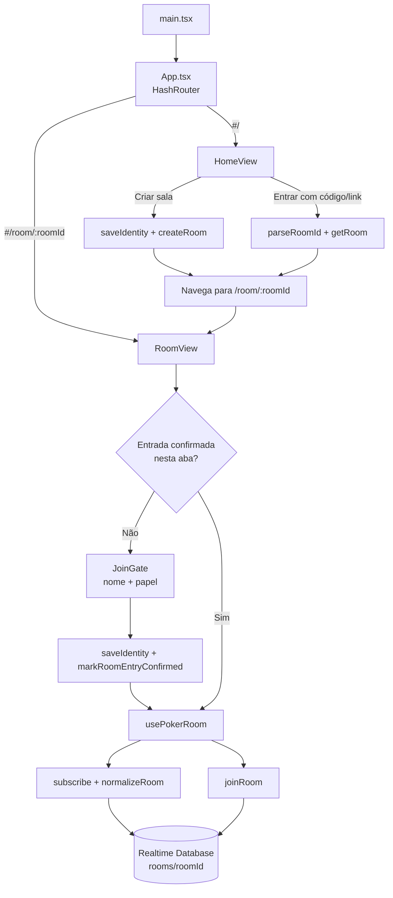
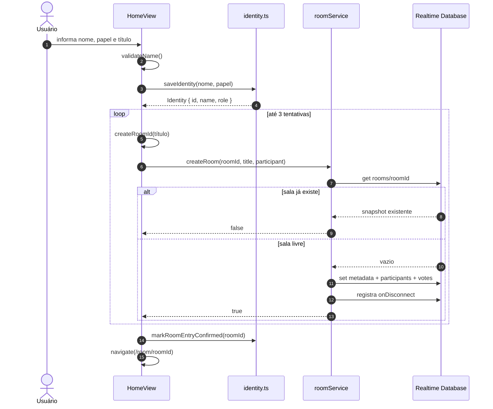
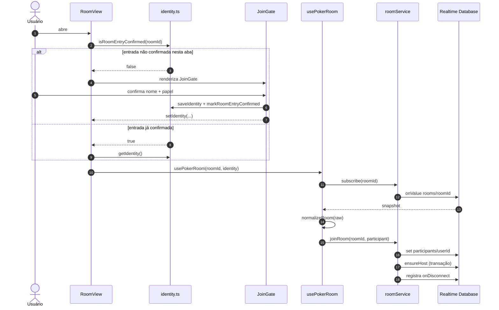
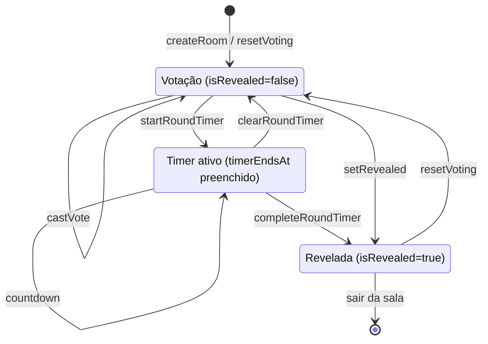
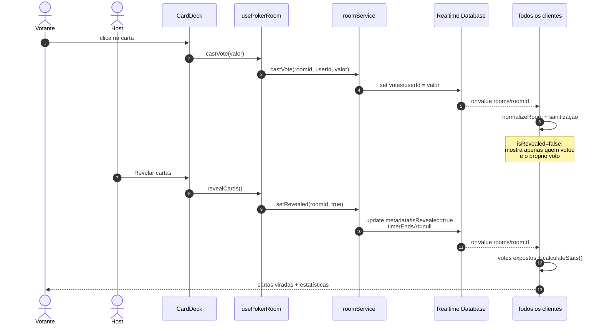
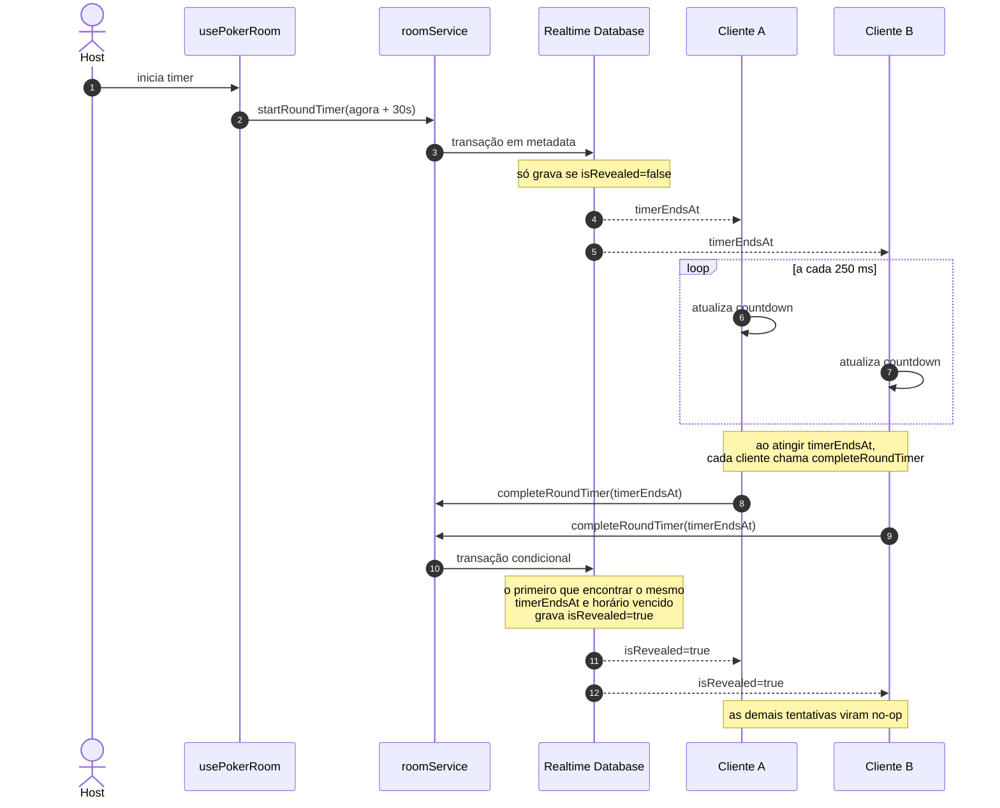
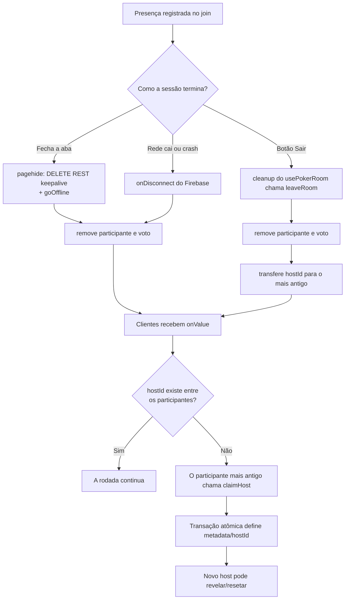

# Fluxo de execução

[← Voltar ao README](../README.md)

Esta documentação descreve como a aplicação se comporta em execução: navegação, criação/entrada em salas, votação, revelação, timer e presença. Os diagramas usam **Mermaid** e são renderizados diretamente no GitHub.

## Mapa de camadas

| Camada | Arquivos | Responsabilidade |
|---|---|---|
| Bootstrap / rotas | `src/main.tsx`, `src/App.tsx` | Renderiza o app e define `#/` e `#/room/:roomId` com `HashRouter`. |
| Telas | `src/views/HomeView.tsx`, `src/views/RoomView.tsx` | Criação/entrada na sala e composição da mesa (header, cartas, estatísticas). |
| Componentes | `src/components/*` | `JoinGate`, `CardDeck`, `VoteTable`, `StatsPanel`, `RoundTimer`, etc. |
| Orquestração | `src/hooks/usePokerRoom.ts` | Assina a sala, faz join, sanitiza votos, controla timer e presença. |
| Contrato | `src/services/contract.ts` | Interface única usada pela UI. |
| Backend | `src/services/firebaseService.ts`, `src/services/localService.ts` | Implementações Firebase Realtime Database e localStorage. |
| Seleção de backend | `src/services/roomService.ts` | Usa Firebase quando as variáveis `VITE_FIREBASE_*` existem; caso contrário, modo local. |
| Normalização | `src/services/normalize.ts` | Valida e aplica defaults aos dados vindos do banco. |
| Identidade / estatísticas | `src/lib/identity.ts`, `src/lib/stats.ts` | UUID anônimo persistido e cálculo de média/moda/consenso. |

---

## 1. Navegação e entrada na sala

**Leitura do fluxo:**

- A rota é sempre resolvida no cliente (`HashRouter`), então recarregar a página funciona no GitHub Pages.
- Abrir um link de sala **sempre** passa pelo `JoinGate` na primeira vez daquela aba. A confirmação fica em `sessionStorage`; recarregar a mesma aba não pergunta de novo.
- Só depois de existir identidade e confirmação de entrada o hook `usePokerRoom` é habilitado.
- O hook assina a sala e faz o join; a partir daí toda mudança chega por `onValue`.

---

## 2. Criação de sala

O `roomId` é um token aleatório de 26 caracteres base32 (~130 bits), sem relação com o título. Se houver colisão, o `HomeView` tenta novamente (até 3 vezes). O criador já nasce como `hostId` e como primeiro participante.

---

## 3. Entrada por link compartilhado

**Detalhes:**

- `joinRoom` grava `name`, `role` e `joinedAt`.
- Se a sala ainda não tiver host válido, `ensureHost` usa transação para eleger o participante mais antigo sem duas abas virarem host ao mesmo tempo.
- `onDisconnect` remove presença e voto se a conexão cair.
- Se a sala não existir, `RoomView` mostra "Sala não encontrada".

---

## 4. Estados de uma rodada

- **Votação:** `votes` recebe valores, mas só quem votou é exposto aos outros.
- **Timer:** `metadata.timerEndsAt` é um timestamp absoluto; todos os clientes contam o tempo.
- **Revelada:** os valores de `votes` são expostos e as estatísticas são calculadas.
- **Nova rodada:** limpa `votes`, zera o timer e volta `isRevealed` para `false`.

---

## 5. Votação e revelação

**Pontos de controle na UI:**

- Clicar na carta já selecionada limpa o voto (`castVote(..., null)`).
- Observadores não recebem o deck clicável.
- O botão **Revelar cartas** só habilita para o host, com pelo menos um voto e com a rodada ainda fechada.
- O botão **Nova rodada** só habilita para o host quando existe voto ou a rodada está revelada.
- As estatísticas (`StatsPanel`) só aparecem após a revelação; o confete dispara quando há consenso.

---

## 6. Timer de 30 segundos

O timer pode ser cancelado pelo host (`clearRoundTimer`). Revelar manualmente ou iniciar nova rodada também limpa `timerEndsAt`. Como a decisão final é uma transação que compara o timestamp esperado, não há revelação duplicada nem sobrescrita fora de hora.

---

## 7. Presença e troca de host

**Comportamentos importantes:**

- Fechar a aba limpa a presença imediatamente via REST com `keepalive`, sem esperar o timeout do long-polling.
- Restaurar a página pelo back/forward cache força um reload, porque a presença já foi removida.
- Se a presença do próprio usuário desaparecer (por exemplo, outra aba com a mesma identidade foi fechada), o hook tenta reentrar com um intervalo mínimo de 5 segundos.
- Quando o host sai, o participante mais antigo assume. A transação `claimHost` evita que dois clientes se declarem host ao mesmo tempo.

---

## 8. Observações de execução

- **O backend é escolhido uma vez:** `roomService.ts` decide entre Firebase e modo local no carregamento do módulo.
- **Ocultação de votos é no cliente:** antes da revelação, `usePokerRoom` remove `votes` do estado exposto. As regras abertas do banco não impedem leitura direta pela API.
- **Normalização centralizada:** todo dado vindo do banco passa por `normalizeRoom`, que aplica defaults, valida papéis/cartas e ignora votos de não participantes.
- **Salas não são apagadas automaticamente:** quando todos saem, o nó `rooms/{roomId}` permanece no banco.
- **Modo local:** replica o mesmo fluxo em `localStorage` + `BroadcastChannel`, sem rede e sem `onDisconnect`.

Para o significado de cada campo do banco, consulte [`banco-de-dados.md`](banco-de-dados.md).
